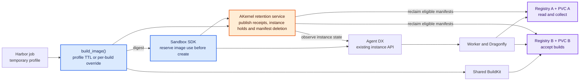

# Temporary image retention

The `harbor-ephemeral` SDK profile provides a configurable publication lifetime
for single-Dockerfile jobs. The AKernel retention service owns publication and
sandbox-use records in a small SQLite database on its own persistent volume.
The SDK calls the existing ADX instance APIs. Deploy the service and the updated
SDK and managed tools together.



## Configure

- Provision two independent private Registry endpoints with separate storage.
  Configure an existing Sandboxd managed-runtime profile for each endpoint.
  Use the corresponding names `harbor-ephemeral-a` and `harbor-ephemeral-b`,
  and set their repository prefix to `akernel-ephemeral`. The SDK alias selects
  the current writable endpoint. A publication retains its Registry authority.
- Copy [the example configuration](config.example.json). The default TTL is
  86400 seconds and the default maximum is 604800 seconds. New publications use
  the policy at admission, and their expiry starts when the Registry digest is
  verified. Leave `auto_delete` false to inspect candidates during rollout.
- Run one service replica with `retention.py` and `registry.py` on a private
  HTTPS endpoint. Mount the SQLite directory on an independent persistent
  volume. Mount separate credentials for the trusted Harbor runner, the ADX
  instance observer, and the Registry token issuers. The ADX observer must be
  able to query instances created by that runner. Grant Registry manifest-delete
  access only to the retention identity and the dedicated temporary prefix.
- Configure Harbor's `managed_runtime_profile` as `harbor-ephemeral` for
  single-Dockerfile data synthesis. Set `AKERNEL_IMAGE_RETENTION_URL` and
  `AKERNEL_IMAGE_RETENTION_TOKEN_FILE` in the runner's environment with the
  trusted CA installed. Keep temporary references within that runner's
  AKernel SDK admission path. Use the ordinary durable profile for Compose,
  reusable snapshots, and independent image consumers.

```sh
python3 retention.py --config /etc/retention/config.json \
  --database /var/lib/retention/state.sqlite serve --listen 0.0.0.0 \
  --tls-cert /etc/retention/tls/tls.crt --tls-key /etc/retention/tls/tls.key
```

The service protects busy, paused and pending instances after TTL. An owned
SDK sandbox reports a confirmed DELETE when Harbor stops the environment.
The service then verifies that ADX has removed that instance before releasing
the image hold. ADX can retire a lost worker's directory entry without
contacting it, so a missing entry alone keeps the hold in place.

Inspect `status` for unresolved holds. Use `cancel-hold --confirmed-absent`
for a create known never to have started. An operator who verifies physical
teardown of an existing sandbox can use `release-hold --confirmed-stopped`.
The latter also checks that the instance is absent from ADX.

## Reclaim and rotate

Use the same configuration and database when running operator commands.
`sweep` lists expired and unreferenced manifest candidates. With `auto_delete`
enabled, the service periodically applies those candidates. It verifies the
original tag and manifest graph and records the deletion worklist before
deleting. Interrupted deletions resume that exact worklist.

1. Verify the standby endpoint can publish and serve an owned image, then run
   `switch <standby>`. New builds go to the standby. Already planned
   publications can finish on the previous target.
2. Drain accepted writes on the previous Registry and fence its BuildKit
   writers. Let manifest reclamation run for eligible images before switching
   that Registry to read-only. Disable its upload purger for the maintenance
   window. Then run `seal <old> --writers-fenced` to reconcile interrupted
   publications against the Registry.
3. Run Distribution's GC dry run and then GC against only the fenced storage
   with its exact Registry version and configuration. Keep its read path
   available. Use the default mark-and-sweep options, which retain manifests
   addressable only by digest. Record actual bytes freed and verify retained
   digests before resuming writes.
4. Restore the retired Registry's writable configuration. After it passes
   write and read smoke checks, run `ready <old>` to make it eligible for a
   later switch.

For the first cleanup of a legacy storage domain, review its retained-reference
inventory and verify recoverability on a clone. Historic repositories are
outside the automatic manifest policy. The Registry sweep covers its whole
filesystem and requires a no-writer window for that filesystem.
[Distribution 3.1.2 maintenance](https://github.com/distribution/distribution/blob/v3.1.2/docs/content/about/garbage-collection.md)
