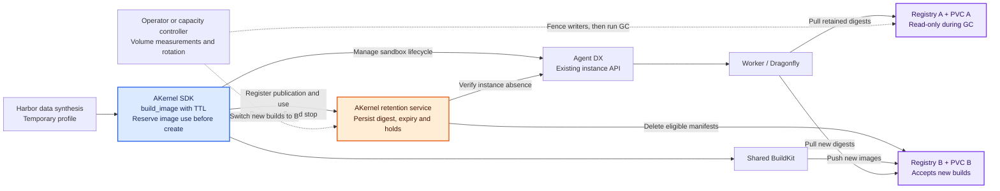

# Temporary image retention

The `harbor-ephemeral` SDK profile provides a configurable publication lifetime
for single-Dockerfile jobs. The AKernel retention service owns publication and
sandbox-use records in a small SQLite database on its own persistent volume.
The SDK calls the existing ADX instance APIs. Deploy the service and the updated
SDK and managed tools together.



Blue marks the SDK changes, orange marks the retention service, and purple
marks the two independent storage endpoints. The diagram shows B active during
A's GC window. The service can sweep eligible manifests on A before A is sealed.
During GC, workers keep pulling retained digests from A's original endpoint.

## Configure

- Provision two independent private Registry endpoints with separate storage.
  Configure an existing Sandboxd managed-runtime profile for each endpoint.
  Use the corresponding names `harbor-ephemeral-a` and `harbor-ephemeral-b`,
  and set their repository prefix to `akernel-ephemeral`. The SDK alias selects
  the current writable endpoint. A publication retains its Registry authority.
- Copy [the example configuration](config.example.json). The default TTL is
  86400 seconds and the default maximum is 604800 seconds. New publications use
  the policy at admission, and their expiry starts when the Registry digest is
  verified. Leave `auto_delete` false to inspect candidates during rollout.
- Run one service replica with `retention.py`, `registry.py` and `capacity.py` on a private
  HTTPS endpoint. Mount the SQLite directory on an independent persistent
  volume. Mount separate credentials for the trusted Harbor runner, the ADX
  instance observer, and the Registry token issuers. The ADX observer must be
  able to query instances created by that runner. Grant Registry manifest-delete
  access only to the retention identity and the dedicated temporary prefix.
- Configure Harbor's `managed_runtime_profile` as `harbor-ephemeral` for
  single-Dockerfile data synthesis. Set `AKERNEL_IMAGE_RETENTION_URL` and
  `AKERNEL_IMAGE_RETENTION_TOKEN_FILE` in the runner's environment with the
  trusted CA installed. Keep temporary references within that runner's
  AKernel SDK admission path. Use the ordinary durable profile for Compose,
  reusable snapshots, and independent image consumers.

```sh
python3 retention.py --config /etc/retention/config.json \
  --database /var/lib/retention/state.sqlite serve --listen 0.0.0.0 \
  --tls-cert /etc/retention/tls/tls.crt --tls-key /etc/retention/tls/tls.key
```

The service protects busy, paused and pending instances after TTL. An owned
SDK sandbox reports a confirmed DELETE when Harbor stops the environment.
The service then verifies that ADX has removed that instance before releasing
the image hold. ADX can retire a lost worker's directory entry without
contacting it, so a missing entry alone keeps the hold in place.

Inspect `status` for unresolved holds. Use `cancel-hold --confirmed-absent`
for a create known never to have started. An operator who verifies physical
teardown of an existing sandbox can use `release-hold --confirmed-stopped`.
The latter also checks that the instance is absent from ADX.

## Capacity management

For bursty builds, enable the optional `capacity` configuration and run one
maintenance process alongside the service. Both processes use the same
configuration and SQLite volume. Set `auto_delete` to enable rotation and
manifest deletion. The capacity process measures both Registry volumes even
while a GC command is running. Start it before sending builds to the profile.

```json
"capacity": {
  "driver": "/etc/retention/registry-maintenance",
  "storage_ids": {"a": "registry-a-volume-uid", "b": "registry-b-volume-uid"},
  "high_watermark_percent": 80,
  "low_watermark_percent": 65,
  "max_in_flight_builds": 16,
  "poll_seconds": 10,
  "max_sample_age_seconds": 60,
  "rotation_interval_seconds": 21600,
  "drain_seconds": 1800,
  "driver_timeout_seconds": 3600,
  "lru_idle_seconds": null
}
```

```sh
python3 retention.py --config /etc/retention/config.json \
  --database /var/lib/retention/state.sqlite maintain
```

Admission stops at the high watermark and resumes at the low watermark. Both
publication reservation and permission to push check volume measurements and
the per-writer limit on in-flight builds. A missing or stale measurement closes
admission for that slot. A rejected request returns HTTP 503 with code
`REGISTRY_CAPACITY_UNAVAILABLE`. Size the headroom and concurrency limit for the
largest concurrent builds because the registry learns blob sizes during upload.

The controller rotates at the high watermark or on the configured interval.
It also rotates when the build limit stays occupied by stale plans, so an
interrupted publication can be reconciled after fencing. Set
`rotation_interval_seconds` to zero to disable periodic rotation.
Rotation starts new builds on a healthy standby and gives planned builds on the
retiring slot up to `drain_seconds` to finish before fencing. Set that window
for the build time you want to allow during rotation. The controller can reclaim
a full standby first when both slots are above their watermarks. If neither
slot has room, callers wait for maintenance or capacity to recover. Inspect
`status` for the measurements, queued maintenance, and publication states.

Set `lru_idle_seconds` to a positive idle grace to allow early eviction of
temporary images published with that policy. The receipt exposes
`pressure_evictable`. Pressure maintenance first sweeps expired publications,
then considers opted-in publications in order of their last confirmed sandbox
stop. Never-used images keep their TTL. A hold still protects any live or
uncertain sandbox, including an instance occasionally reading a Nydus blob.
Scheduled rotation uses the TTL policy. Each sweep considers up to 256
publications, with space usage remeasured after physical GC.

### Maintenance driver

Supply a deployment-owned executable at `capacity.driver`. The controller runs
it directly with three arguments, `<action> <slot> <storage-id>`. Bind each slot
to its existing endpoint and independent filesystem or PVC, and verify the
provided storage identity on every action. Use the Registry volume's measured
filesystem capacity. All actions must be safe to retry after a timeout or a
restart.

| Action | Required behavior |
| --- | --- |
| `measure` | Write a JSON object to stdout with `storage_id`, `total_bytes`, `available_bytes` and `writable` (boolean). Verify the mounted volume, reachable Registry and effective write mode. This action may run during another action. |
| `fence` | Drain or stop outstanding writers for this slot, keep the original read endpoint, put the Registry in read-only mode and disable the upload purger. Keep this fence in effect throughout GC, including across driver restarts. |
| `gc` | Recheck the identity and write fence, then dry-run and run Distribution GC with the same Registry version and configuration. Serialize the GC process on that volume and return success only when it has completed. |
| `restore` | Verify that GC has stopped, restore the writable Registry and pass a push/read smoke check on the same endpoint before reporting success. |

Run the driver with the permissions scoped to these two Registries. Its
`measure` loss or a failed step keeps the affected slot out of new build
selection. The controller keeps the maintenance job in SQLite and retries it.
When providing the driver for Kubernetes, validate it against the dedicated
namespace and the actual PVC identities before enabling it for that deployment.

## Reclaim and rotate

Use the same configuration and database when running operator commands.
`switch`, `seal` and `ready` can be used for manual rotation when the
maintenance process is stopped and its queue is empty.
`sweep` lists expired and unreferenced manifest candidates. With `auto_delete`
enabled, the service periodically applies those candidates. It verifies the
original tag and manifest graph and records the deletion worklist before
deleting. Interrupted deletions resume that exact worklist.

1. Verify the standby endpoint can publish and serve an owned image, then run
   `switch <standby>`. New builds go to the standby. Already planned
   publications can finish on the previous target.
2. Drain accepted writes on the previous Registry and fence its BuildKit
   writers. Let manifest reclamation run for eligible images before switching
   that Registry to read-only. Disable its upload purger for the maintenance
   window. Then run `seal <old> --writers-fenced` to reconcile interrupted
   publications against the Registry.
3. Run Distribution's GC dry run and then GC against only the fenced storage
   with its exact Registry version and configuration. Keep its read path
   available. Use the default mark-and-sweep options, which retain manifests
   addressable only by digest. Record actual bytes freed and verify retained
   digests before resuming writes.
4. Restore the retired Registry's writable configuration. After it passes
   write and read smoke checks, run `ready <old>` to make it eligible for a
   later switch.

For the first cleanup of a legacy storage domain, review its retained-reference
inventory and verify recoverability on a clone. Historic repositories are
outside the automatic manifest policy. The Registry sweep covers its whole
filesystem and requires a no-writer window for that filesystem.
[Distribution 3.1.2 maintenance](https://github.com/distribution/distribution/blob/v3.1.2/docs/content/about/garbage-collection.md)
